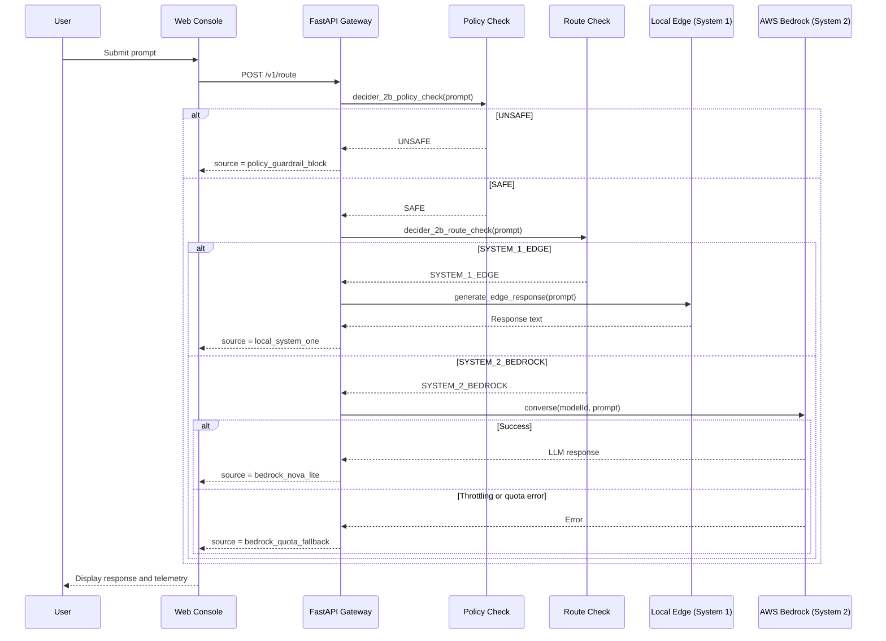

# Sentry-Gate: Enterprise AI Routing System

## Abstract
Sentry-Gate is an enterprise AI gateway prototype that applies the **Strands Decider 2B decision pattern** at the perimeter. Every prompt passes through a policy check (`#policy`) and a routing check (`#model-routing`) before anything reaches a cloud model. Simple queries are resolved by a local edge router (System 1); complex workloads are escalated to Amazon Bedrock Nova Lite (System 2). Both checks are rule-based classifiers that return typed decisions with measured evaluation time.

## 1. Introduction
Modern AI applications face trade-offs between response latency, operational cost, security, and model capability. Sending every prompt to a cloud frontier model adds latency and token cost, and exposes the model to prompt injection. Sentry-Gate addresses this by evaluating each request at the edge first: unsafe prompts are blocked, simple prompts are answered locally, and only complex prompts reach AWS Bedrock. This document describes the system architecture, components, API, deployment, and known limitations.

## 2. System Architecture
The system has three stages coordinated by a FastAPI gateway: a policy check, a routing check, and one of two execution paths (local edge or AWS Bedrock).

### 2.1 Architectural Sequence Diagram


### 2.2 Component Responsibilities
- **Web Console (`index.html`)**: Single-page frontend with a fluid-simulation hero, prompt console, preset test prompts, and running telemetry.
- **FastAPI Gateway**: REST API (`POST /v1/route`) with CORS enabled; also serves the console at `GET /`.
- **Policy Check (`#policy`)**: Matches the prompt against a keyword blocklist and returns `SAFE` or `UNSAFE`.
- **Route Check (`#model-routing`)**: Rule-based classifier returning `SYSTEM_1_EDGE` or `SYSTEM_2_BEDROCK`.
- **Local Edge (System 1)**: Scripted, rule-based responses for simple prompts, with no cloud call.
- **Cloud LLM (System 2)**: Amazon Nova Lite on AWS Bedrock, called through the Converse API.
- **Quota Fallback**: Returns a fixed response when Bedrock reports a throttling or token-quota error.

## 3. Components

### 3.1 sentry_gate.py (FastAPI Backend)
- **Framework**: FastAPI, served with Uvicorn
- **Core Class**: `SentryGate`
- **Dependencies**: `fastapi`, `uvicorn`, `boto3`, `pydantic`
- **Key Methods**:
  - `__init__()`: Creates the Bedrock client from environment credentials (or the default AWS credential chain)
  - `decider_2b_policy_check(prompt) -> dict`: `#policy` check; returns `decision` and `eval_latency_ms`
  - `decider_2b_route_check(prompt) -> dict`: `#model-routing` check; returns `decision` and `eval_latency_ms`
  - `generate_edge_response(prompt) -> str`: System 1 scripted responses
  - `route_query(prompt) -> dict`: Runs policy check, routing check, execution, and fallback handling
  - `_call_bedrock_live(prompt) -> str`: Bedrock Converse API wrapper

### 3.2 index.html (Web Console)
- **Stack**: Plain HTML, CSS, and JavaScript. Uses a WebGL fluid simulation background and Lenis smooth scroll (loaded from a CDN).
- **Features**:
  - Prompt input with preset test prompts (greeting, factual, architecture, policy block)
  - Chat-style log showing each response with a badge for its `source`, total latency, and evaluation time
  - Telemetry tiles: total executions, System 1 count, System 2 count, policy blocks
  - Backend status indicator
- **Backend URL**: Same origin when served from the FastAPI app on port 8000. Otherwise defaults to `http://localhost:8000`, or the value of `window.SENTRY_API` if set.

### 3.3 Requirements
Core Python dependencies:
```
fastapi
uvicorn
boto3
pydantic
```
Install with `pip install -r requirements.txt`.

## 4. API Specification

### 4.1 Endpoints

#### Query Routing
- **URL**: `POST /v1/route`
- **Description**: Runs a prompt through the policy check, then the routing check, and returns the result.
- **Request**:
  ```json
  {
    "prompt": "string (non-empty)"
  }
  ```
- **Response (routed prompt, example values)**:
  ```json
  {
    "source": "bedrock_nova_lite",
    "response": "...",
    "metrics": {
      "total_latency_ms": 1150.45,
      "route_eval_ms": 0.042,
      "pattern": "#model-routing"
    }
  }
  ```
- **Response (blocked prompt, example values)**:
  ```json
  {
    "source": "policy_guardrail_block",
    "response": "Request Blocked by Sentry-Gate Security Policy: Malicious injection or policy violation detected.",
    "metrics": {
      "total_latency_ms": 0.05,
      "policy_eval_ms": 0.004,
      "pattern": "#policy"
    }
  }
  ```
- **Possible `source` values**:
  1. `local_system_one`: handled locally at the edge
  2. `bedrock_nova_lite`: answered by Amazon Bedrock Nova Lite
  3. `bedrock_quota_fallback`: Bedrock hit a throttling or quota error; fixed fallback response returned
  4. `policy_guardrail_block`: stopped by the policy blocklist before routing
- **Status Codes**:
  - `200 OK`: Successful routing (including policy blocks and quota fallbacks)
  - `400 Bad Request`: Empty prompt
  - `422 Unprocessable Entity`: Missing or invalid request body
  - `503 Service Unavailable`: Gateway still initializing
  - `500 Internal Server Error`: Bedrock error other than throttling or quota

#### Frontend
- **URL**: `GET /`
- **Description**: Serves `index.html` if it exists in the working directory; otherwise returns a plain "API Online" page.

### 4.2 Data Models
- **RouteRequest**:
  - `prompt`: User-submitted text query
- **RouteResponse**:
  - `source`: Identifier of the path that produced the response (see values above)
  - `response`: Response text
  - `metrics`: Object containing:
    - `total_latency_ms`: End-to-end processing time in the gateway
    - `policy_eval_ms`: Policy check time (present on blocked prompts)
    - `route_eval_ms`: Routing check time (present on routed prompts)
    - `pattern`: `#policy` or `#model-routing`

## 5. Deployment

### 5.1 Prerequisites
- Python 3.8+
- AWS account with Bedrock access to Amazon Nova Lite
- AWS credentials supplied through environment variables, the AWS CLI, or an IAM role
- Network access to AWS Bedrock endpoints

### 5.2 Installation Procedure
1. Clone repository:
   ```bash
   git clone https://github.com/AchsahGraceW/strands-sentry-gate.git
   cd strands-sentry-gate
   ```
2. Create virtual environment (recommended):
   ```bash
   python -m venv venv
   source venv/bin/activate  # Linux/macOS
   venv\Scripts\activate     # Windows
   ```
3. Install dependencies:
   ```bash
   pip install -r requirements.txt
   ```
4. Configure AWS credentials:
   ```bash
   export AWS_ACCESS_KEY_ID="your_access_key"
   export AWS_SECRET_ACCESS_KEY="your_secret_key"
   export AWS_DEFAULT_REGION="us-east-1"
   ```
   Alternatively, run `aws configure`. Required IAM permissions: `bedrock:InvokeModel`, `bedrock:Converse`.

### 5.3 Execution
Start the service:
```bash
python sentry_gate.py
# or
uvicorn sentry_gate:app --host 0.0.0.0 --port 8000 --reload
```

Open the console at `http://localhost:8000`. The API is available at the same address.

If you host `index.html` separately (for example on Vercel), set `window.SENTRY_API` to your deployed backend URL before the page script runs. CORS is enabled on the API.

### 5.4 Configuration
- **AWS Region**: Set the `AWS_DEFAULT_REGION` environment variable (default: `us-east-1`)
- **Model ID**: Update `self.model_id` in `SentryGate.__init__()` (default: `us.amazon.nova-lite-v1:0`)
- **Policy Blocklist**: Edit `unsafe_keywords` in `decider_2b_policy_check()`
- **Routing Rules**: Edit `complex_keywords` and the word-count threshold (currently 15 words) in `decider_2b_route_check()`

## 6. Performance Notes
This repository does not include a formal benchmark suite, and no benchmark figures are published here.

Each response reports its own timing in `metrics`:
- `policy_eval_ms` or `route_eval_ms`: time spent in the local decision check. These checks are in-process substring matches, so they are expected to be very small.
- `total_latency_ms`: total time spent in the gateway. For Bedrock-routed prompts this is dominated by the network round trip and model inference time.

Run your own measurements by sending representative prompts to `POST /v1/route` and reading these fields.

## 7. Limitations
- The "Decider 2B" logic is a rule-based implementation of the pattern. No 2B-parameter model runs in this repository.
- The policy check is a small substring blocklist. It shows where a perimeter check sits; it is not a complete defense against prompt injection.
- System 1 responses are scripted templates, not model output.
- The quota fallback returns a fixed response; it does not generate an answer to the user's prompt.
- There is no authentication on the API, and CORS is open to all origins.

## 8. Licensing
This software is licensed under the Apache License, Version 2.0 (the "License");
you may not use this file except in compliance with the License.
You may obtain a copy of the License at

    http://www.apache.org/licenses/LICENSE-2.0

Unless required by applicable law or agreed to in writing, software
distributed under the License is distributed on an "AS IS" BASIS,
WITHOUT WARRANTIES OR CONDITIONS OF ANY KIND, either express or implied.
See the License for the specific language governing permissions and
limitations under the License.

## 9. References
1. AWS Bedrock Documentation: https://docs.aws.amazon.com/bedrock/
2. Amazon Nova Lite Model Card: https://docs.aws.amazon.com/bedrock/latest/userguide/model-cards.html
3. FastAPI Documentation: https://fastapi.tiangolo.com/
4. Dual-process theory in cognitive science: Kahneman, D. (2011). Thinking, Fast and Slow.

## Revision History
| Version | Date | Description |
|---------|------|-------------|
| 1.0.0   | 2026-10-19 | Initial release: heuristic router with Streamlit interface |
| 2.4.0   | 2026-10-23 | Added Decider 2B policy and routing checks, quota fallback, and web console; removed Streamlit interface and cost metrics |
